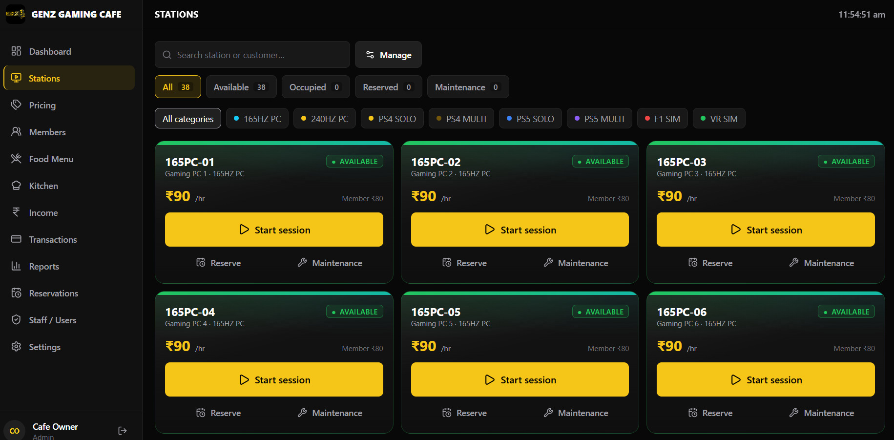
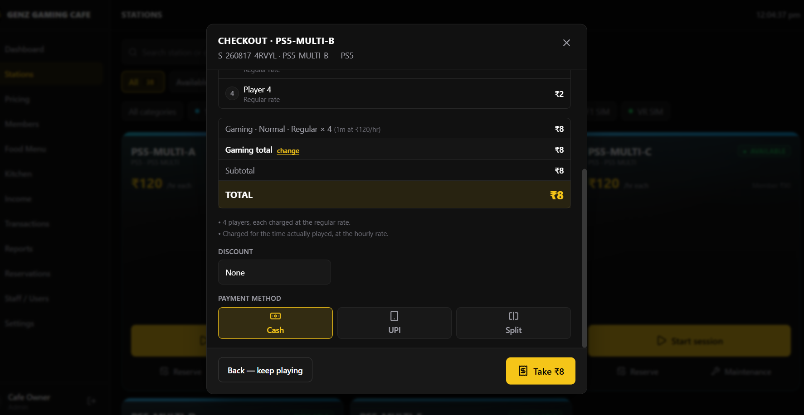

# GENZ Gaming Cafe

**A management and point-of-sale system that runs a real gaming cafe.**
Live in production on Vercel, in daily commercial use, handling real money and
real customer records.


Staff open a station, a timer starts, food gets added, the bill builds itself,
and payment closes it out — cash, UPI, or split between them. Behind that: member
pricing, night rates, day passes, multi-player sessions, reservations, role-based
staff accounts, an append-only audit log, and reporting the owner actually uses.

> Not a portfolio exercise. Every feature below exists because someone behind a
> counter needed it, and most of the engineering decisions were forced by that.

---

## Contents

- [Features](#features)
- [Stack](#stack)
- [How it's built](#how-its-built)
- [Engineering problems worth reading about](#engineering-problems-worth-reading-about)
- [Testing](#testing)
- [Running locally](#running-locally)
- [Screenshots](#screenshots)

---

## Features

| Area | What it does |
| --- | --- |
| **Stations** | Live board with search, status and category filters; per-station colour theming |
| **Sessions** | Timestamp-based timers, pause/resume (paused time never charged), add-time, live running bill |
| **Multi-player** | Several players on one station, each priced at their own rate over the same clock |
| **Food** | In-session ordering that flows onto the same bill |
| **Checkout** | Frozen bill, cash / UPI / validated split payment, 80 mm thermal receipts, auditable manual override |
| **Members** | Encrypted Aadhaar, renewal history, per-member visit and spend history, bulk spreadsheet import |
| **Pricing** | Regular/member × normal/night × any duration slabs, day passes, per-minute or slab billing mode |
| **Reservations** | Booking with conflict detection |
| **Staff** | Accounts, roles, per-role discount ceilings |
| **Oversight** | Append-only audit log, dashboard, income, transactions, reports, CSV export |

Nothing operational is hard-coded. Prices, categories, tax, roles, discount
limits, station colours and the cafe's own logo are all editable in the app by a
non-technical owner.

---

## Stack

**Next.js 16** (App Router, Server Actions) · **TypeScript** strict ·
**Tailwind CSS v4** · **Radix UI** · **Recharts** · **PostgreSQL** (Supabase) ·
**Drizzle ORM** with plain-SQL migrations · **Zod** · **bcrypt** + signed cookie
sessions · **Vitest** · **Playwright**

Deployed on **Vercel**, functions pinned to `bom1` (Mumbai) to sit beside the
database. ~15,400 lines of TypeScript across 117 files.

<details>
<summary>Why Drizzle instead of Prisma</summary>

Prisma was the original choice, but its engine binaries couldn't be fetched in
the build environment — which would have meant shipping code that was never
compiled or run. Drizzle hits the same PostgreSQL target with pure TypeScript, no
native binary, and plain-SQL migrations, so the whole system could be built,
migrated, seeded, tested and screenshotted end to end.

</details>

---

## How it's built

**A pure core with thin edges.** Pricing, bill splitting, CSV parsing, import
rules and image validation live in dependency-free modules under `src/lib`. They
take data and return data — no database, no request object, no clock. That's what
makes the money logic exhaustively testable instead of sampled.

**Bills are frozen, never recomputed.** Every transaction stores its full pricing
breakdown as JSON. Changing tomorrow's prices cannot rewrite yesterday's
receipts.

**State is snapshotted where it applies.** A player's membership status is
captured at the moment they're seated, so a renewal three days later can't
retroactively alter a bill that was already paid.

**The database enforces the invariants that matter.** One live session per
station, split payments must balance, no member seated twice in one session,
member pricing must name a member — CHECK constraints and unique indexes, not
just application code.

**Server-side authority.** Every mutation is a Server Action that re-validates
with the same Zod schema the form used and re-checks the caller's role.
Browser-side validation is treated as a courtesy, never a control.

---

## Engineering problems worth reading about

<details open>
<summary><b>Pricing elapsed time is not one multiplication</b></summary>

A single sitting can cross a night-rate boundary *and* a membership expiry. The
engine splits elapsed time into segments at every boundary, prices each at the
rate actually in force, sums them, then compares the total against the day pass
and charges whichever is cheaper. Pauses cut the segments further. Multi-player
sessions run the same clock through each seat at that player's own rate.

Four players on a ₹180/hr station, three of them members at ₹150/hr → ₹630/hr.

</details>

<details>
<summary><b>Slab pricing is a covering problem, not a lookup</b></summary>

With 30-minute and 1-hour slabs configured, 50 minutes costs the price of the
hour — not the hour plus the half hour. The engine finds the cheapest combination
of slabs that covers the played time, combining slabs for durations beyond the
largest configured one.

</details>

<details>
<summary><b>Then the owner needed the opposite behaviour</b></summary>

Slab pricing is right for a cafe selling packages and wrong for one selling time
— a 61-minute session shouldn't cost two hours. Rather than replace it,
per-minute pro-rata became a second billing mode behind a setting. Only the
minutes→money step differs; segment splitting, day-pass comparison and
per-player charging are shared.

The hourly rate used is deliberately the same number the station card displays,
so the board and the bill can never disagree in front of a customer.

</details>

<details>
<summary><b>Importing 500 real customers had two traps</b></summary>

**Historical revenue.** Membership income is summed by creation date, so
importing years of history would have shown up as one enormous day of takings.
Imported memberships are dated to the start of their term instead.

**Ambiguous dates.** `05/09/2026` is either 5 September or 9 May, and guessing
wrong shifts 500 expiry dates silently — surfacing months later, one angry
customer at a time. The importer reads the whole column to decide: a single
`15/08/2026` proves day-first, because there is no fifteenth month. When the
column is genuinely ambiguous it says so and asks, rather than picking quietly.

</details>

<details>
<summary><b>Serverless and Postgres need deliberate care</b></summary>

Functions defaulted to a US region while the database sits in Mumbai — visible as
slow pages and intermittent 500s. Fixed by pinning `regions: ["bom1"]` and
hardening the pool for serverless: one connection, keepAlive, recovery from
dropped idle clients.

Separately, `pg` now treats `sslmode=require` in a connection URL as verify-full
and lets URL values override passed options, so TLS parameters are stripped from
the URL and set explicitly.

</details>

<details>
<summary><b>Vercel's filesystem is read-only, so the logo lives in the database</b></summary>

Telling a non-technical owner to drop a file into `public/` was never reasonable,
and on Vercel it doesn't work at all — the filesystem is replaced on deploy. The
logo is stored in the settings row and served from an API route with an ETag. The
browser downsizes whatever is picked onto a canvas before upload, so a phone
photo becomes ~100 KB of plain pixels.

SVG uploads are refused on purpose: an SVG is a document, not pixels, and serving
a user-supplied one from our own origin would let it run scripts against the
signed-in session.

</details>

<details>
<summary><b>A test caught the bug a user would have hit first</b></summary>

The logo endpoint sat behind the auth guard, so it redirected to the login page —
meaning it could never have rendered on the sign-in screen, the one place a
cafe's logo matters most.

</details>

---

## Testing

**Unit and real-database tests** — the pricing engine (night crossing, midnight,
mid-session membership expiry, pauses, day passes, rounding), multi-player
pricing, bill splitting under a deterministic invariant sweep, money formatting,
timezone helpers, CSV parsing against what Sheets/Excel/Numbers actually export,
and the database-level guarantees above.

**Playwright end-to-end** on desktop *and* phone viewports — sign in → start
session → add food → end → split payment → receipt; a four-player session through
to its receipt; a timer surviving a page reload; every route rendering; auth
redirects.

`tsc --noEmit`, ESLint (Next 16 + React Compiler rules) and a production build
all run clean.

Migrations touching live data are rehearsed against a database built at the
previous migration and loaded with real-shaped history before they ship.

---

## Running locally

```bash
npm install
cp .env.example .env.local     # DATABASE_URL, AUTH_SECRET, ENCRYPTION_KEY
npm run db:migrate
npm run db:seed                # prints the seed admin account
npm run dev
```

| Command | |
| --- | --- |
| `npm run dev` | development server |
| `npm run typecheck` | `tsc --noEmit` |
| `npm run lint` | ESLint |
| `npm test` | unit + database tests |
| `npm run test:e2e` | Playwright, desktop + phone |
| `npm run db:studio` | browse the database |

Setup, deployment, pricing and architecture documentation lives in [`docs/`](docs/).

---

## Screenshots

<!--
Add screenshots here, taken against a SEEDED LOCAL database — never the live
cafe. No real customer names, mobile numbers, Aadhaar numbers or takings.

| Stations board | Live session |
| --- | --- |
|  |  |

| Checkout | Reports |
| --- | --- |
|  |  |
-->

*Coming shortly.*

---

## Status

In production since 2026, running a working cafe. Features and fixes are driven
by the owner using the system on the floor.
